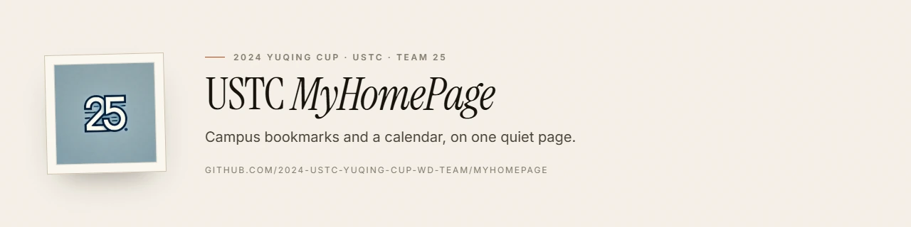

# WD Team · USTC

**Team 25 of the 2024 USTC Yuqing Cup** · Honorable Mention

## Who we are

We are two USTC undergraduates — “WD” comes from the initials of our surnames —
who built a small start page for campus life during the 2024 Yuqing Cup campus
software design competition. The organisation is kept as an archive of that
work: the code still runs, the documentation explains how, and nothing pretends
to be under active development.

## What we built

| Project | What it is | Stack |
| --- | --- | --- |
| [**myhomepage**](https://github.com/2024-ustc-yuqing-cup-wd-team/myhomepage) | Campus bookmarks + personal calendar, static and local-first | HTML · CSS · vanilla JS · FullCalendar |
| [**orangepi-server**](https://github.com/2024-ustc-yuqing-cup-wd-team/orangepi-server) | Nginx + systemd deployment for the Orange Pi LAN server | Nginx · Node.js · Express |

Both repositories are bilingual (English / 中文), MIT licensed and documented.

## The 2024 entry

The project, “USTC MyHomePage” (科大个人主页), started from a simple observation:
on a PC, students still juggle the academic portal, mail, Blackboard, 瀚海 and
the library across separate tabs. We built a single start page that holds the
most-used links and a calendar, with all data kept in the browser so it works on
an offline campus LAN.

It ran on an Orange Pi behind Nginx and received an **Honorable Mention** in the
2nd USTC Yuqing Cup Campus Software Design Competition.

## 中文简介

2024 年余庆杯第 25 队（队名取自两位成员姓氏首字母）。作品「科大个人主页」把常用的
校园站点和日程放在同一个起始页里，数据只存在浏览器本地；比赛期间部署在 Orange Pi +
Nginx 的校园局域网环境中，获得 Honorable Mention。仓库目前作为比赛存档维护，
不再继续开发。

## Contact

Bug reports and documentation fixes are welcome through the issue tracker of the
relevant repository. For anything security-related, use the repository's private
vulnerability reporting form.
